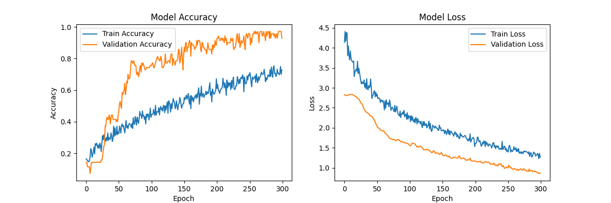
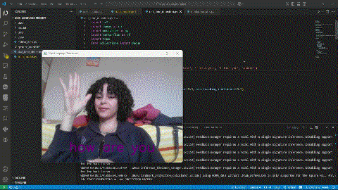
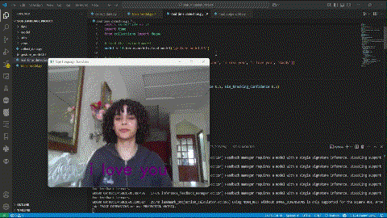
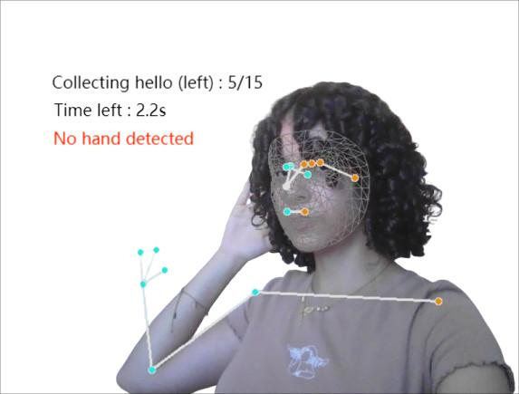
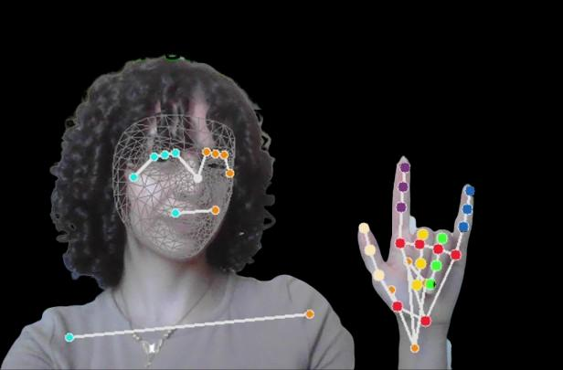
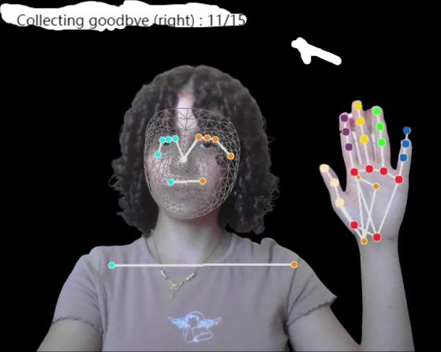

# ✋ Sign Language Translator

A real-time sign language gesture recognition system using **MediaPipe Holistic** + **Bidirectional LSTM** deep learning. Translates hand gestures into text to bridge communication gaps for the deaf and hard-of-hearing community.

---

## 🎯 Overview

| Aspect | Detail |
|--------|--------|
| **Problem** | Limited sign language proficiency among the general population hinders interaction |
| **Solution** | Real-time gesture → text translation via webcam |
| **Framework** | MediaPipe Holistic (hand & body landmark detection) |
| **Model** | Bidirectional LSTM (sequence classification) |
| **Gestures** | `hello` · `goodbye` · `yes` · `no` · `thank you` · `i love you` · `blank` |

---

## 🏗️ System Architecture

The system is structured in **three core phases**:

### 1. Data Collection (`collect_data.py`)
- Captures **50 video sequences per gesture**, each **15 frames** long
- Uses webcam input with robust error handling
- Extracts keypoints for **both left and right hands**
- User prompts ensure high-quality data acquisition

### 2. Model Training (`train_model.py`)
- Data augmentation (rotation, noise) for generalization
- Trains a **Bidirectional LSTM** on an 80/20 train/test split
- Uses **class weights** and **early stopping** to optimize performance
- Validation: confusion matrix, accuracy metrics

### 3. Real-Time Detection (`real_time_detection.py`)
- Integrates the trained model with live video feeds
- Uses a **15-frame sliding window** for gesture classification
- Additional validation: finger counts + palm orientation checks
- Displays results and confidence scores on the video feed

### Supporting Module
- **`mediapipe_utils.py`** — Keypoint extraction, preprocessing, and visualization

---

## 📊 Model Performance



---

## 📁 Repository Contents

| File | Purpose |
|------|---------|
| `collect_data.py` | Gesture data collection from webcam |
| `train_model.py` | Model training with augmentation |
| `real_time_detection.py` | Live gesture recognition |
| `mediapipe_utils.py` | MediaPipe keypoint processing utilities |
| `python check_data.py` | Data validation script |
| `gesture_model.keras` | Trained model weights |
| `label_encoder_classes.npy` | Gesture label mapping |
| `gesture_data/` | Collected training data |
| `model/` | Model artifacts |
| `utils/` | Shared utilities |
| `README_images/` | Training history chart |

---

## 🎬 Demo Videos

**Clipchamp Demo:**

| |
|---|
|  |

**Hello & I Love You Demo:**

| |
|---|
|  |

---

## 📸 App Screenshots

| Screenshot 1 | Screenshot 2 | Screenshot 4 |
|---|---|---|
|  |  |  |

---

## 📎 Supporting Documents

- **Full project report:** `sign_language_project docs/Repprt Ranym Moussa final version .pdf` (42 pages — requirements, design, implementation, results) — *personal document, not in repository*
- **Demo video:** `sign_language_project docs/Untitled video - Made with Clipchamp.mp4` (2.9s)
- **Demo video 2:** `sign_language_project docs/hello and i love you.mp4` (4.8s)

---

## 🚀 Running the Project

```bash
# 1. Collect training data
python collect_data.py

# 2. Train the model
python train_model.py

# 3. Real-time detection
python real_time_detection.py
```

**Requirements:** Python 3.10+, TensorFlow/Keras, MediaPipe, OpenCV, NumPy

---

*This repository is private. © 2026 Ranym Moussa.*